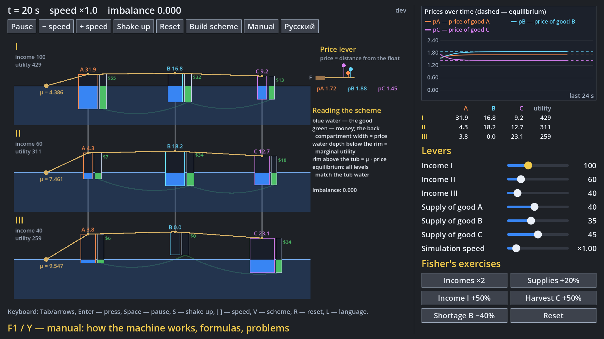
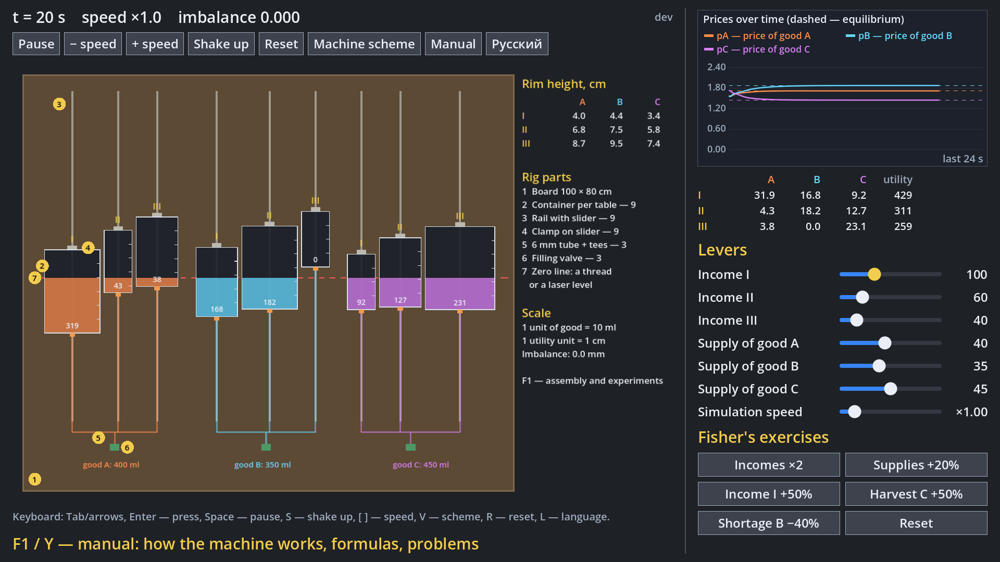
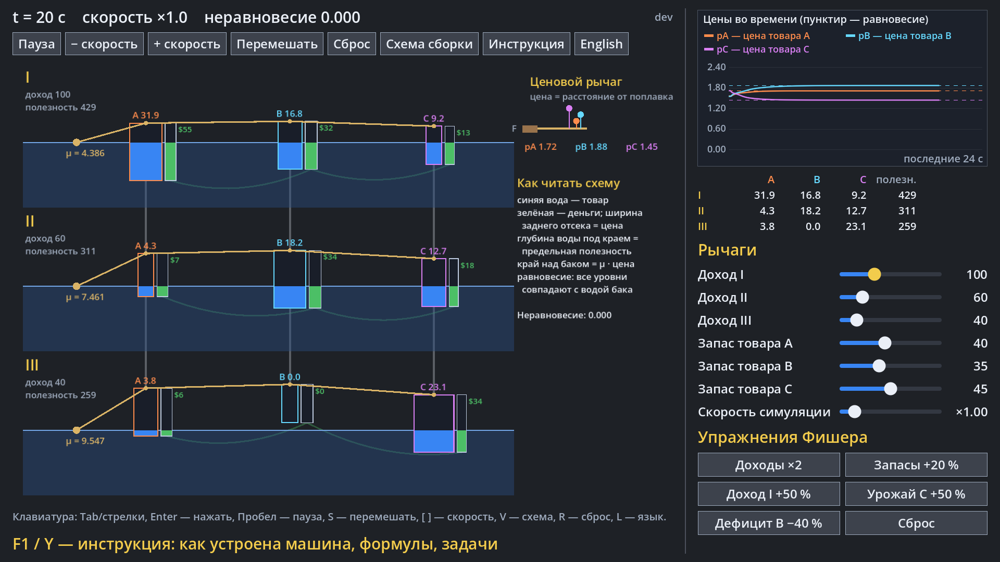
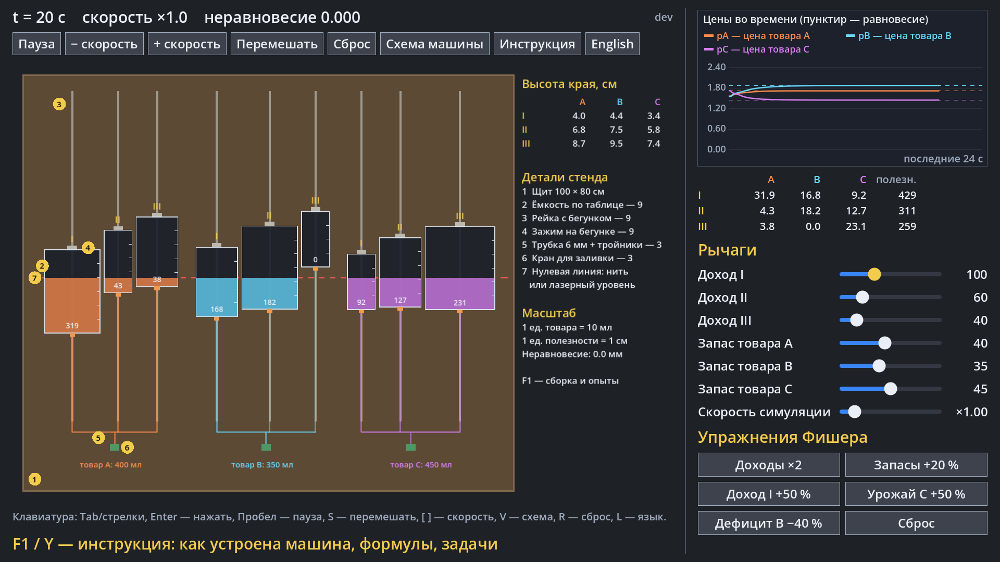

# Fisher Machine

[English](#english) · [Русский](#русский)

## English

A Godot 4.7 simulation of **Irving Fisher's hydrostatic machine** (1891): cisterns, levers and floats in a tub of
water that compute equilibrium prices for three consumers and three goods. A companion to the
[Phillips Machine (MONIAC)](https://github.com/avv123avv/phillips_machine): MONIAC pumps the *flows* of a whole economy,
Fisher's machine finds the *prices* — who buys what and at what price.



**Download (Windows):** the latest build is on the [Releases](https://github.com/avv123avv/fisher_machine/releases/latest)
page — unpack the zip and run `FisherMachine.exe`. Every merge into `main` publishes a new version automatically.

**Run from source:** Godot 4.7 → Import → select `project.godot` → F5. The screen is 1920×1080 and scales down to
smaller displays (e.g. Steam Deck 1280×800); GL Compatibility renderer. The UI language follows the system on first
launch; switch it with the **English / Русский** button, **L** or the gamepad **Select** button.

### How it works

Each of the 9 cisterns (consumer × good) is shaped so that the depth of its water surface below the rim equals the
buyer's **marginal utility** of the amount of the good in it (rectangular cisterns = quadratic utility). The front
compartments of one good are joined by a tube and hold its whole supply; the back compartments are as thick as the
price and hold money, and those of one consumer are joined and hold his income. Levers keep the rims at heights
proportional to prices. The machine comes to rest only when every level matches the tub water — exactly Fisher's
equilibrium:

**u′ᵢⱼ(xᵢⱼ) = λᵢ·pⱼ,   Σⱼ pⱼxᵢⱼ = Yᵢ,   Σᵢ xᵢⱼ = Eⱼ**

The mechanics follow the reconstruction by Brainard and Scarf (2005): fast levers moved by the weight of water,
slow water flowing through the tubes. The program also solves the equations directly and draws the answer dashed on
the price chart.

### Controls

| Gamepad | Keyboard | Action |
|---|---|---|
| D-pad / left stick | arrows, Tab | move between controls |
| ← / → on a slider | ← / → | change an income or supply |
| A | Enter | press a button |
| X | Space | pause / run |
| Start | S | shake up: split the water evenly and let the machine search again |
| Y | F1 | manual (←/→ or LB/RB flip, B / Esc close, O opens the PDF) |
| Select | L | language |
| LB / RB | [ / ] | simulation speed ÷2 / ×2 |
| L3 (left stick press) | V | build scheme / machine scheme |
| — | R | reset |

Levers: incomes of I, II, III and supplies of A, B, C. Fisher's exercises: Incomes ×2, Supplies +20%, Income I +50%,
Harvest C +50%, Shortage B −40%.

### Build it at home



The **Build scheme** button shows a tabletop version made of communicating vessels: nine rectangular containers on
rails with sliders, the containers of one good joined at the bottom by a tube (one food colour per good), and a zero
line (a thread or a laser level) playing the role of the tub water. Fisher's levers and leather bellows are replaced
by the program: it shows how high to set each container's rim. Then the water spreads by itself exactly as Fisher's
equations predict — every surface comes to the zero line, and a container whose bottom is above the line stays empty
(that buyer does not buy that good). Scale: 1 unit of good = 10 ml, 1 unit of marginal utility = 1 cm of depth.
Section 8 of the manual has the parts list, container sizes, the settings for the default equilibrium and experiments.

### Manual

[`docs/instruction_en.pdf`](docs/instruction_en.pdf): history, how a cistern encodes taste, how the machine works,
Fisher's equations, controls, Fisher's exercises with numbers, and five problems (the printing press, a bumper
harvest, a crop failure, a tax on the rich, when a good becomes free) and how to build it at home. In the game it opens with F1 / Y. Both PDFs and
the in-game pages are generated by:

```
pip install reportlab pypdfium2
python docs/build_instruction.py
```

### Tests

```
godot --headless --path . --import
godot --headless --path . -s tests/run_tests.gd
```

CI runs them on every push and PR and builds a Windows exe.

Source: W. C. Brainard, H. E. Scarf, “How to Compute Equilibrium Prices in 1891”, *American Journal of Economics and
Sociology* 64(1), 2005.

## Русский

Симуляция **гидростатической машины Ирвинга Фишера** (1891) на Godot 4.7: цистерны, рычаги и поплавки в баке с водой,
которые находят равновесные цены для трёх покупателей и трёх товаров. Пара к
[машине Филлипса (MONIAC)](https://github.com/avv123avv/phillips_machine): MONIAC гоняет *потоки* целой экономики, а машина
Фишера находит *цены* — кто что купит и почём.



**Скачать (Windows):** последняя сборка — на странице [Releases](https://github.com/avv123avv/fisher_machine/releases/latest):
распакуйте zip и запустите `FisherMachine.exe`. Каждое слияние в `main` автоматически выпускает новую версию.

**Запуск из исходников:** Godot 4.7 → Import → выбрать `project.godot` → F5. Экран 1920×1080, масштабируется под
меньшие (например, Steam Deck 1280×800); рендерер GL Compatibility. Язык при первом запуске — как в системе;
переключение кнопкой **English / Русский**, клавишей **L** или кнопкой **Select** на геймпаде.

### Как это работает

Каждая из 9 цистерн (потребитель × товар) устроена так, что глубина поверхности воды под краем равна **предельной
полезности** налитого в неё количества товара (прямоугольные цистерны — квадратичная полезность). Передние отсеки
одного товара соединены трубкой и вмещают весь его запас; задние отсеки толщиной в цену хранят деньги, отсеки одного
потребителя соединены и вмещают его доход. Рычаги держат края цистерн на высотах, пропорциональных ценам. Машина
успокаивается, только когда каждый уровень совпал с водой бака, — это и есть равновесие Фишера:

**u′ᵢⱼ(xᵢⱼ) = λᵢ·pⱼ,   Σⱼ pⱼxᵢⱼ = Yᵢ,   Σᵢ xᵢⱼ = Eⱼ**

Механика — по реконструкции Брейнарда и Скарфа (2005): быстрые рычаги, которые двигает вес воды, и медленная вода в
трубках. Программа также решает уравнения напрямую и рисует ответ пунктиром на графике цен.

### Управление

| Геймпад | Клавиатура | Действие |
|---|---|---|
| крестовина / левый стик | стрелки, Tab | переход между элементами |
| ← / → на слайдере | ← / → | изменить доход или запас |
| A | Enter | нажать кнопку |
| X | Пробел | пауза / пуск |
| Start | S | перемешать: вода поровну, машина ищет равновесие заново |
| Y | F1 | инструкция (←/→ или LB/RB — листать, B / Esc — закрыть, O — открыть PDF) |
| Select | L | язык |
| LB / RB | [ / ] | скорость симуляции ÷2 / ×2 |
| L3 (нажатие левого стика) | V | схема сборки / схема машины |
| — | R | сброс |

Рычаги: доходы I, II, III и запасы A, B, C. Упражнения Фишера: Доходы ×2, Запасы +20 %, Доход I +50 %, Урожай C +50 %,
Дефицит B −40 %.

### Собрать дома



Кнопка **Схема сборки** показывает настольную версию из сообщающихся сосудов: девять прямоугольных ёмкостей на
рейках с бегунками, ёмкости одного товара соединены снизу трубкой (свой краситель на товар), нулевая линия (нить или
лазерный уровень) играет роль воды в баке. Рычаги и кожаные меха Фишера заменяет программа: она показывает, на какую
высоту поставить край каждой ёмкости. Дальше вода расходится сама ровно так, как предсказывают уравнения Фишера, —
все поверхности выходят на нулевую линию, а ёмкость, чьё дно выше линии, остаётся пустой (этот покупатель этот товар
не берёт). Масштаб: 1 единица товара = 10 мл, 1 единица предельной полезности = 1 см глубины. В разделе 8 инструкции —
список деталей, размеры ёмкостей, настройка для равновесия по умолчанию и опыты.

### Инструкция

[`docs/instruction_ru.pdf`](docs/instruction_ru.pdf): история, как цистерна задаёт вкус, как устроена машина,
уравнения Фишера, управление, упражнения Фишера с числами и пять задач (печатный станок, богатый урожай, неурожай,
налог на богатого, когда товар становится бесплатным) и как собрать машину дома. В игре открывается по F1 / Y. Оба PDF и страницы для игры
собирает скрипт:

```
pip install reportlab pypdfium2
python docs/build_instruction.py
```

### Тесты

```
godot --headless --path . --import
godot --headless --path . -s tests/run_tests.gd
```

CI запускает их на каждый push и PR и собирает exe для Windows.

Источник: W. C. Brainard, H. E. Scarf, «How to Compute Equilibrium Prices in 1891», *American Journal of Economics and
Sociology* 64(1), 2005.
